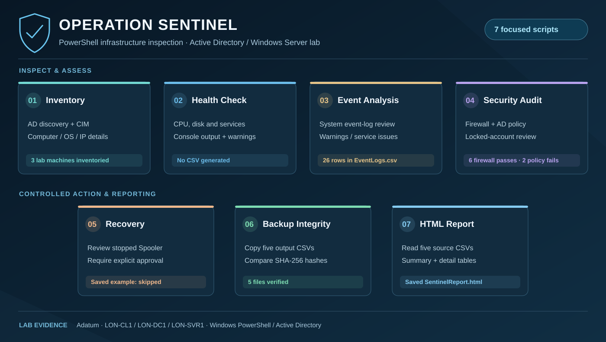

# Operation Sentinel

**Windows Server & Active Directory administration | PowerShell | MSSA lab**

<p align="center"></p>

Operation Sentinel is a seven-script PowerShell project I built in the Microsoft Software & Systems Academy (MSSA) Windows Server lab. It brings together infrastructure inventory, health checks, Windows event analysis, security review, an approval-controlled service-recovery exercise, backup verification, and HTML reporting.

**Lab environment:** Adatum Active Directory domain, Windows Server 2019, Windows 10, and PowerShell. This is a hands-on **lab implementation**, not a production monitoring platform or a Microsoft Sentinel SIEM deployment.

## Scenario & purpose

An IT administrator supporting multiple Windows computers needs a repeatable way to answer a few basic questions: What machines are in the domain? Are server resources and services healthy? What recent event-log warnings need attention? Do firewall and domain settings meet the lab's checks? If a test service stops, can the administrator review the issue before taking action?

I developed Operation Sentinel to investigate those questions with PowerShell and keep inspectable outputs for follow-up. The scripts are connected through their reports, but **they are run individually** in this version; there is no scheduled monitoring service or single-command launcher.

## Workflow



### Source scripts

The original scripts are retained under [**Sentinel/**](Sentinel/) with their existing names and paths.

| Step | Script | Purpose and output |
| --- | --- | --- |
| 01 | [Inventory.ps1](Sentinel/Inventory.ps1) | Discovers domain computers with Active Directory, queries Windows system details through CIM, and exports [Inventory.csv](Inventory.csv). |
| 02 | [Health Check.ps1](Sentinel/Health%20Check.ps1) | Reviews server CPU usage, disk space, and key services; prints threshold warnings to the console. **No health CSV was produced.** |
| 03 | [EventAnalysis.ps1](Sentinel/EventAnalysis.ps1) | Retrieves recent System log events, filters non-informational records, checks service-related events, and exports [EventLogs.csv](EventLogs.csv). |
| 04 | [Security Audit.ps1](Sentinel/Security%20Audit.ps1) | Checks firewall profiles, domain password-policy settings, and locked accounts; exports [FirewallResults.csv](FirewallResults.csv) and [DomainResults.csv](DomainResults.csv). |
| 05 | [Recovery.ps1](Sentinel/Recovery.ps1) | Looks for stopped Spooler services, asks for explicit approval before starting a selected service, and writes [RecoveryResults.csv](RecoveryResults.csv). |
| 06 | [BackupInterity.ps1](Sentinel/BackupInterity.ps1) | Copies five report CSVs into a timestamped folder, compares SHA-256 hashes, and exports [BackupAudit.csv](BackupAudit.csv). *The source filename retains its original spelling.* |
| 07 | [Report.ps1](Sentinel/Report.ps1) | Reads five source CSVs and combines their tables with a record-count summary into [SentinelReport.html](SentinelReport.html). |

### PowerShell approach

The scripts use **Active Directory cmdlets**, **CIM**, **PowerShell remoting**, **Windows event logs**, **custom objects**, CSV files, and SHA-256 checksums.

For example, the event-analysis script uses remoting to retrieve recent System events from the servers found in AD:

```powershell
$Events = Invoke-Command -ComputerName $Servers.Name -ScriptBlock {
    Get-WinEvent -LogName System -MaxEvents 100
}
```

For backup verification, the original and copied files are hashed and compared before the audit is written:

```powershell
$OriginalHash = (Get-FileHash $File.FullName -Algorithm SHA256 -ErrorAction Stop).Hash
Copy-Item $File.FullName $Destination -ErrorAction Stop
$BackupHash = (Get-FileHash $Destination -Algorithm SHA256 -ErrorAction Stop).Hash
$Status = if ($OriginalHash -eq $BackupHash) { "Verified" } else { "Mismatch" }
```

These excerpts illustrate the existing code; they are not new or rewritten versions of the scripts.

## Results & evidence

The repository includes actual output files saved from the Adatum lab. The following are **observed results**, not estimates.

| Evidence | Recorded result |
| --- | --- |
| [Infrastructure inventory](Inventory.csv) | **3 machines**: LON-CL1, LON-DC1, and LON-SVR1. |
| [Windows event review](EventLogs.csv) | **26 saved event records** for follow-up. These are not automatically confirmed security incidents. |
| [Firewall checks](FirewallResults.csv) | **6 Pass** entries across the Domain, Private, and Public profiles on the two servers. |
| [Domain policy](DomainResults.csv) | Password length **Fail**; complexity **Pass**; lockout threshold **Fail** against the script's lab criteria. **0 locked accounts** recorded. |
| [Controlled recovery](RecoveryResults.csv) | Approval was **N**; the Spooler action was **Skipped**. This does **not** demonstrate a successful restart. |
| [Backup integrity](BackupAudit.csv) | **5 files Verified** by matching source and copied SHA-256 hashes. See the [saved backup snapshot](SentinelBackups/20261028_144215_202/). |
| [HTML report](SentinelReport.html) | Generated an HTML summary and detail tables from **five CSV sources**: inventory, domain, events, firewall, and recovery. |

The HTML report does **not** include the backup audit or a health-check CSV. The health-check script displays results in the console instead of exporting a file.

**What this demonstrates:** I used PowerShell to inspect a small Windows domain, surface configuration and event findings, preserve reports, and verify copies of the resulting CSVs. The recovery script has an approval gate, but the saved example documents a **skipped** action rather than a verified repair.

## Navigating and extending the code

- **Review the existing code:** Start with [Sentinel/](Sentinel/), then follow the scripts in the order above.
- **Change inventory fields:** Look at the CIM queries and `[PSCustomObject]` in [Inventory.ps1](Sentinel/Inventory.ps1).
- **Adjust health thresholds:** Look for CPU, disk, and WinRM checks in [Health Check.ps1](Sentinel/Health%20Check.ps1).
- **Review audit rules:** See the password-policy and firewall result objects in [Security Audit.ps1](Sentinel/Security%20Audit.ps1).
- **Change the recovery safeguards:** Start with the approval prompt, service selection, and verification logic in [Recovery.ps1](Sentinel/Recovery.ps1).
- **Change report contents:** See the input filename arrays in [BackupInterity.ps1](Sentinel/BackupInterity.ps1) and [Report.ps1](Sentinel/Report.ps1).

**Run only in an appropriate Windows lab.** These original scripts assume the Adatum environment, available AD/remote-management access, and a hard-coded output folder under the lab administrator's desktop. Some commands query remote systems, and the recovery exercise can start a service if approved. The files have been preserved for mentor review; they have **not been modified, refactored, or retested during this documentation update**.

Original outputs, backups, the generated report, the [project document](Sentinel%20project.docx), and VS Code settings remain in their existing locations.
